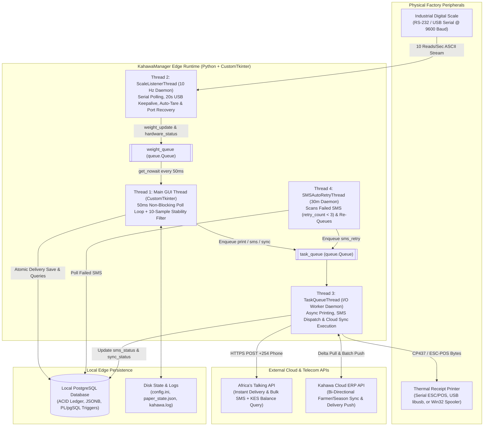
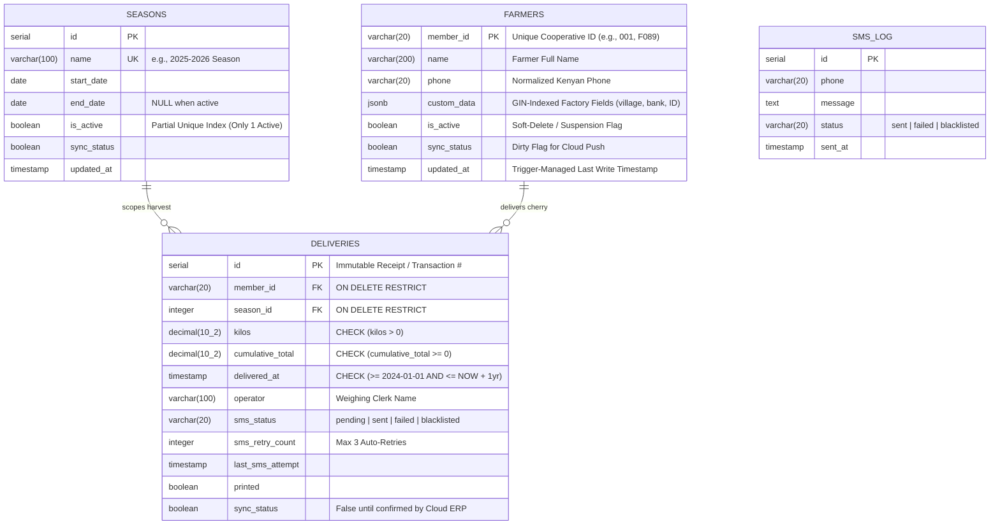
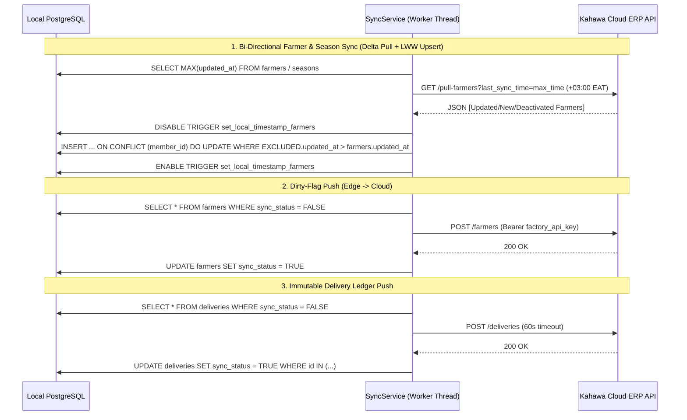

<div align="center">
  <h1>☕ KahawaManager (Edge & Cloud Sync Edition)</h1>
  <p><strong>Offline-First Industrial Coffee Factory Weighing, Hardware Telemetry & Cloud Synchronization System</strong></p>

  <p>
    
    
    
    
    
  </p>

  <p>
    <a href="#-executive-summary">Executive Summary</a> •
    <a href="#-the-problem--field-constraints">Field Constraints</a> •
    <a href="#-multi-threaded-system-architecture">Architecture</a> •
    <a href="#-database-schema--plpgsql-engine">Database Design</a> •
    <a href="#-core-engineering-highlights">Engineering Highlights</a> •
    <a href="#-application-modules">Modules</a> •
    <a href="#-screenshots--interface-preview">Screenshots</a> •
    <a href="#-packaging--deployment">Deployment</a> •
    <a href="#-contact--codebase-walkthrough">Contact</a>
  </p>
</div>

---

> **📌 Note on Source Code Visibility:**  
> *KahawaManager is a commercial industrial software system deployed at coffee cooperative factories in Kenya, and its primary repository is private. This public repository serves as the **System Architecture & Engineering Case Study**, documenting the hardware-software integration, multi-threaded concurrency model, offline-first PostgreSQL design, and bi-directional Cloud ERP synchronization protocols. Hiring managers, CTOs, and technical reviewers are welcome to [reach out](#-contact--codebase-walkthrough) for a live demonstration or codebase walkthrough.*

---

## 🚀 Executive Summary

**KahawaManager** is an offline-first, hardware-integrated desktop and edge computing system engineered for Kenyan coffee cooperative societies and wet mills. Deployed directly at factory weighing stations, it interfaces with **digital industrial scales via RS-232/USB serial ports**, **thermal receipt printers (ESC/POS)**, **local PostgreSQL databases**, **Africa's Talking SMS gateways**, and a **centralized Cloud ERP**.

Designed specifically for rural factory environments with intermittent internet connectivity, power fluctuations, and high peak-harvest queues, KahawaManager processes farmer cherry deliveries in milliseconds on the local edge while asynchronously handling receipt printing, SMS confirmations, and bi-directional cloud synchronization in background worker threads.

---

## 🌍 The Problem & Field Constraints

Building software for rural agricultural processing factories introduces harsh physical and operational constraints that standard web applications cannot survive:

1. **Unreliable Rural Internet Connectivity:**  
   Coffee factories sit in rural agricultural zones where internet drops frequently during heavy rains (peak harvest season). A purely cloud-based web app halts the entire weighing line when the network drops, leaving hundreds of farmers stranded with perishable coffee cherry.
2. **Hardware Instability & Windows COM Port Reassignment:**  
   Factory clerks unplug USB-to-Serial cables, Windows power-saving puts USB ports to sleep, and re-plugging a scale or thermal printer often causes Windows to silently reassign `COM3` to `COM8`. Furthermore, weighing scales bounce when a heavy sack is dropped onto the plate, leading to inaccurate manual readings.
3. **Clerk Bottlenecks & Ledger Manipulation:**  
   Paper ledgers and manual weight entry are slow and prone to human error or fraud. Additionally, synchronous printing (2–3s) and synchronous HTTP SMS requests (5–10s) would freeze a single-threaded UI for ~12 seconds per farmer.
4. **Motherboard CMOS Battery Failures:**  
   Factory desktop PCs frequently suffer dead CMOS batteries after power outages, resetting the Windows clock to `1970-01-01` or `2000-01-01` and corrupting chronological financial records.

**KahawaManager** solves all four problems through an **Offline-First Edge Architecture**, **Hardware Auto-Discovery & Signal Stabilization**, **Multi-Threaded Producer-Consumer Queues**, and **Multi-Layer Database & System Integrity Guards**.

---

## 🏗️ Multi-Threaded System Architecture

To guarantee a **60 FPS non-blocking UI** for the weighing clerk while simultaneously polling serial hardware at **10 Hz** and executing network/printer I/O, KahawaManager uses a **4-Thread Producer-Consumer Architecture** orchestrated via thread-safe Python `queue.Queue` pipelines.



### Technology Stack Breakdown

| Layer | Technologies Used | Engineering Role |
| :--- | :--- | :--- |
| **Desktop GUI** | Python 3.13, `CustomTkinter`, `Tkinter`, `Pillow` | Modern, accessible desktop interface with dynamic font scaling (`1.0x`, `1.25x`, `1.5x`), Dark/Light themes, and audio feedback. |
| **Hardware Telemetry** | `pyserial`, `python-escpos`, `pywin32` (`win32print`) | 10 Hz serial scale reading, automated COM port probing, and 3-mode thermal receipt printing (`SERIAL`, `WINDOWS`, `USB_ESCPOS`). |
| **Local Database** | PostgreSQL, `psycopg2`, `PL/pgSQL`, `JSONB` | Local ACID storage with GIN-indexed `JSONB` custom farmer attributes, reporting views, and timestamp triggers. |
| **Telecom & Cloud** | `africastalking`, `requests`, `certifi` | Automated `<160 char` SMS receipts, carrier blacklist (`406`) handling, KES balance polling, and Cloud ERP REST sync. |
| **Data & Analytics** | `pandas`, `openpyxl`, `matplotlib` | Multi-sheet Excel season archives, day-of-week delivery analytics, and Two-File smart farmer data importer. |
| **Packaging & OS** | `PyInstaller` (`.spec`), `tendo.singleton`, `wave` | Standalone Windows `.exe` compilation (zero Python install required), lockfile single-instance enforcement, and `.wav` sound cues. |

---

## 🗄️ Database Schema & PL/pgSQL Engine

The local PostgreSQL database (`coffee_factory`) is engineered for zero data loss, schema flexibility across different cooperatives, and offline-to-cloud synchronization.



### Database-Level Integrity & Dynamic Schema Features
* **Dynamic `JSONB` Custom Columns (`custom_data`):** Different coffee factories track different metadata (e.g., `village`, `bank_account`, `id_number`, `trees_count`). Using a GIN-indexed `JSONB` column (`idx_farmers_custom_data`), the Farmers tab dynamically introspects keys via `SELECT DISTINCT jsonb_object_keys(custom_data)` and renders custom table columns at runtime without schema migrations.
* **Single Active Season Enforcement:** Enforced at the PostgreSQL engine level via a partial unique index (`CREATE UNIQUE INDEX idx_seasons_active ON seasons(is_active) WHERE is_active = TRUE`) and managed via the `close_and_start_season()` PL/pgSQL stored function.
* **Pre-Computed Reporting Views:** Includes `season_summary`, `farmer_season_performance`, and `failed_sms_pending_retry` SQL views for instant dashboard and Excel export aggregation.

---

## ⚙️ Core Engineering Highlights

### 1. Industrial Scale Telemetry, Signal Stabilization & Self-Healing COM Discovery
Interfacing with physical serial hardware on Windows requires defensive systems engineering (`app/hardware/scale.py` & `app/hardware/detection.py`):
* **10-Sample Rolling Stability Filter:** To prevent clerks from saving a bouncing weight when a coffee sack hits the scale, the UI maintains a rolling window of the last **10 readings** (1.0 second at 10 Hz). The `SAVE DELIVERY` button only unlocks when:
  $$\max(W_{1..10}) - \min(W_{1..10}) \le 0.2\text{ kg} \quad \land \quad W_{\text{current}} > 0$$
* **USB Power-Saving Keepalive & Auto-Tare:** Windows aggressively suspends idle USB-Serial adapters. `ScaleListenerThread` dispatches a non-intrusive `\r\n` keepalive ping every **20 seconds**. Upon recovering from a mid-session cable disconnect, it automatically transmits a `Z\r\n` (Zero/Tare) command and flushes stale serial input buffers so a load left on the plate doesn't create a negative zero drift.
* **Fast-Path / Slow-Path COM Port Auto-Detection (`HardwareDetector`):** When a cable is moved to a different USB port, the detector probes available ports by transmitting wake-up sequences (`\r\n` for scales, `\x1b@\x05` `ESC @ + ENQ` for ESC/POS printers), validates regex weight signatures or status bytes, resolves port conflicts, rewrites `config.ini` on the fly, and hot-reconnects the background thread without restarting the app.

### 2. Offline-First Bi-Directional Cloud Synchronization (`SyncService`)
`app/services/sync.py` implements an resilient synchronization protocol between the local factory PostgreSQL database and the remote Node.js/Express Cloud ERP every **60 seconds**:



* **Last-Write-Wins (LWW) Conflict Resolution with Trigger Bypass:** During a cloud pull, `SyncService` temporarily disables the local `set_local_timestamp` PostgreSQL trigger, executes a batch `ON CONFLICT DO UPDATE ... WHERE EXCLUDED.updated_at > farmers.updated_at`, marks `sync_status = TRUE`, and re-enables the trigger—preventing infinite ping-pong sync loops between Edge and Cloud.
* **Cloud vs. Edge Health Auditor:** The Admin tab includes a live **System Health & Reconciliation** engine that queries `/health` on the Cloud ERP, compares local vs. cloud counts across `farmers`, `deliveries`, and `seasons`, reports exact discrepancies, and offers a one-click **Force Complete Reconciliation** (`force=True`).

### 3. Resilient SMS Pipeline & Carrier Blacklist Intelligence (`SmsService`)
* **Single-Segment Character Optimization:** Automatically formats delivery receipts to stay under **145 characters** (well below the 160-character GSM 7-bit billing boundary) so factories never pay for double SMS segments per delivery.
* **Safaricom Error `406` (Blacklisted/Sender ID) Circuit Breaker:** Distinguishes between transient network failures and permanent carrier rejections (`statusCode == 406` raised as `BlacklistedNumberError`). While transient failures are retried every **30 minutes** (up to 3 attempts) by `SMSAutoRetryThread`, `406` errors immediately mark `sms_status = 'blacklisted'` and pin `sms_retry_count = 3` so the retry daemon never wastes API calls or locks up the queue.

### 4. Triple-Mode Receipt Printing Engine with Encoding Sanitization
`app/services/printing.py` supports three distinct printing architectures with automatic fallback:
1. **`SERIAL` (Raw ESC/POS over COM):** Constructs byte-level ESC/POS commands (`\x1b@`, alignment, double-height bold headers, and `\x1dV\x00` auto-cutter) with `cp437` character sanitization.
2. **`WINDOWS` (Win32 Print Spooler):** Streams RAW documents directly to `win32print.GetDefaultPrinter()` (`latin-1` / `utf-8`)—serving as an automatic fallback if serial printing fails.
3. **`USB_ESCPOS` (`python-escpos`):** Direct USB printing via `libusb` Vendor/Product IDs (`VID`/`PID`).

### 5. Multi-Layer Data Corruption & Fraud Prevention
* **Dual CMOS Clock Guard:** Validates system time both at application startup (`main.py`), before every delivery save (`weigh.py`), and inside PostgreSQL `CHECK` constraints (`delivered_at >= '2024-01-01'`), blocking transactions if a dead motherboard battery resets the PC clock.
* **Duplicate Delivery Detection:** Detects back-to-back identical or near-immediate deliveries for the same `member_id` and prompts the clerk to confirm whether the farmer is weighing a second separate sack of coffee (`allow_duplicate=True`) or accidentally double-clicking.
* **Process Singleton Lock:** Uses `tendo.singleton` (`kahawa_manager.lock`) to prevent clerks from accidentally opening multiple instances of the application that would fight over exclusive Windows COM port locks.

---

## 🧩 Application Modules

* **⚖️ Weighing Station Tab (`weigh.py`):**
  * Instant Member ID lookup with suspended-account blocking (`is_active == False`), live 72pt weight display, real-time `STABLE` / `UNSTABLE` / `STABILIZING...` indicator, live receipt/SMS preview console, and a built-in **Simulation Slider** for hardware-free development (`scale_port = SIM`).
* **👥 Registered Farmers & 360° Profile (`farmers.py` & `farmer_profile.py`):**
  * Paginated farmer registry (30 per page for instant rendering), real-time ID/Name search, dynamic `JSONB` custom field columns, click-to-open individual farmer profiles, individual SMS dispatch, and one-click Excel export.
* **🛠️ Admin, Hardware & Bulk SMS Center (`admin.py`):**
  * Live Hardware Status indicators (`Scale`, `SMS`, `Printer`) with background **Auto-Detect Hardware** scanner.
  * **Cloud Sync Health Checker** and **Force Complete Reconciliation**.
  * **Farmer Phone Updater** with Kenyan 10-digit validation.
  * **Bulk SMS Campaign Manager:** Send announcements or meeting/payment templates to all farmers or filter by minimum delivery threshold ($\ge X\text{ kg}$), complete with recipient preview and character counter.
  * **Failed SMS Manager:** Interactive modal to inspect, select, and re-queue failed delivery notifications.
* **📊 Delivery Reports & Analytics (`reports.py`):**
  * Filterable by `This Week`, `Last Week`, `This Month`, or `All Time` (scoped to the active season).
  * KPI summary cards (`Total Deliveries`, `Total Weight`, `Avg per Delivery`), **Day-of-Week Breakdown Table** (Monday–Sunday) with per-day `.xlsx` export, and a 100-row live transaction feed with inline SMS retry buttons.
* **📅 Multi-Season Lifecycle Management (`seasons.py`):**
  * One-click **Multi-Sheet Excel Season Archiver** (exports `Season Summary`, `Farmers`, `All Deliveries`, and `Daily Summary` sheets via `openpyxl`) before closing the current harvest season and initializing a new one.
* **🔔 System Alerts, Consumables & Accessibility (`alerts.py`):**
  * **Virtual Thermal Paper Counter:** Tracks remaining receipt capacity across restarts (`paper_state.json`) by subtracting database-verified daily deliveries from the morning paper roll count:
    $$\text{Paper Remaining} = \text{Start of Day} + \text{Added Today} - \text{Deliveries Printed Today}$$
  * **Live Africa's Talking Balance Monitor:** Queries the AT API for real-time KES credit balances and triggers pop-up alerts when paper ($<50$), SMS credits ($<100$), or Cloud Sync ($>24\text{ hrs}$) cross critical thresholds.
  * **Accessibility & Ergonomics:** Global UI font scaling (`Normal`, `Large +25%`, `Extra Large +50%`), instant `Dark`/`Light` mode switching, and configurable `.wav` audio cues (`farmer_found.wav`, `success.wav`, `error.wav`, `alert.wav`).

---

## 📸 Screenshots & Interface Preview

<div align="center">
  <table>
    <tr>
      <td align="center" width="50%">
        
        <br />
        <em><strong>1. Coffee Weighing Station:</strong> Look up a farmer, read the live weight, check stability, preview the receipt, and save the delivery.</em>
      </td>
      <td align="center" width="50%">
        
        <br />
        <em><strong>2. Admin and Hardware Management:</strong> Check the scale, SMS service, and printer, detect hardware, compare local and cloud data, and update farmer phone numbers.</em>
      </td>
    </tr>
    <tr>
      <td align="center" width="50%">
        
        <br />
        <em><strong>3. Farmer Phone Updates and Bulk SMS:</strong> Find a farmer, change the phone number, choose who should receive a message, and use a ready-made message template.</em>
      </td>
      <td align="center" width="50%">
        
        <br />
        <em><strong>4. Bulk SMS and Failed SMS Manager:</strong> Preview recipients, send messages, open the SMS log, and retry messages that failed.</em>
      </td>
    </tr>
    <tr>
      <td align="center" width="50%">
        
        <br />
        <em><strong>5. Delivery Reports and Analytics:</strong> View delivery totals, daily results, recent deliveries, failed SMS messages, and export reports.</em>
      </td>
      <td align="center" width="50%">
        
        <br />
        <em><strong>6. Season Management:</strong> See the active season, review its totals, archive it, or start a new season.</em>
      </td>
    </tr>
    <tr>
      <td align="center" colspan="2">
        
        <br />
        <em><strong>7. System Alerts and Monitoring:</strong> Track printer paper, SMS credits, cloud sync, font size, display mode, and sound settings.</em>
      </td>
    </tr>
  </table>
</div>

---

## 📦 Packaging, Data Migration & Factory Deployment

### 1. Standalone Windows Executable (`KahawaManager.spec`)
Factory PCs do not have Python or developer toolchains installed. Using a custom-engineered **PyInstaller specification**, the entire application is compiled into a standalone Windows distribution (`dist/KahawaManager/KahawaManager.exe`) that bundles:
* `libpq.dll` and `psycopg2` binaries for native PostgreSQL connectivity.
* `certifi` CA certificate bundles for secure HTTPS communication with Africa's Talking and the Cloud ERP.
* `customtkinter` themes, `escpos` device capabilities, `openpyxl` templates, and externalized `.wav` audio assets.

```bash
# Compile standalone Windows distribution
pyinstaller KahawaManager.spec --clean --noconfirm
```

### 2. Two-File Smart Farmer Onboarding Tool (`import_all_farmers.py`)
To migrate factories from messy legacy spreadsheets, the repository includes a dedicated CLI/EXE onboarding utility (`KahawaImporter`):
* **Fuzzy Column Recognition:** Automatically maps variations of `Member ID`, `Farmer Name`, `Cumulative Total`, and `Phone Number` across `.xlsx` and `.csv` files.
* **Auto-JSONB Packing:** Any extra spreadsheet columns (e.g., `Village`, `Bank Account`, `National ID`) are automatically serialized into PostgreSQL `custom_data` `JSONB` attributes.
* **Excel Phone Sanitization:** Repairs common Excel formatting bugs—converting scientific notation (`7.12345e+08` $\rightarrow$ `0712345001`), stripping float decimals (`.0`), and restoring stripped leading zeros on 9-digit Kenyan mobile numbers.

---

## 📂 Project Directory Structure

```text
kahawa_manager_cloud/
├── app/
│   ├── main.py                  # Bootstrapping: CMOS date guard, singleton lock, license & DB checks
│   ├── config/
│   │   ├── paths.py             # PyInstaller _MEIPASS vs. BASE_PATH resolution
│   │   ├── settings.py          # Typed config.ini parser & environment flags
│   │   └── sounds/              # .wav audio feedback cues (alert, confirm, error, farmer_found, success)
│   ├── core/
│   │   ├── exceptions.py        # Domain exceptions (e.g., BlacklistedNumberError)
│   │   ├── license.py           # Factory license validation
│   │   ├── logging_setup.py     # Rotating file & console logger
│   │   ├── sound.py             # Non-blocking audio playback manager
│   │   └── utils.py             # Receipt character encoding sanitizers (cp437 / latin-1 / utf-8)
│   ├── database/
│   │   ├── db_manager.py        # Pooled PostgreSQL connection context manager & atomic queries
│   │   └── migrations.py        # Schema migration runners
│   ├── hardware/
│   │   ├── detection.py         # Fast/Slow-path COM port scanner & auto-config updater
│   │   └── scale.py             # 10 Hz ScaleListenerThread, USB keepalive & auto-tare recovery
│   ├── services/
│   │   ├── alerts.py            # Paper roll math, Africa's Talking KES balance & sync watchdogs
│   │   ├── backup.py            # Cloud snapshot backup service
│   │   ├── printing.py          # 3-mode receipt engine (Serial ESC/POS, Win32 Spooler, USB ESC/POS)
│   │   ├── sms.py               # Africa's Talking dispatch, <145 char formatter & 30m auto-retry thread
│   │   ├── sync.py              # Bi-directional Cloud ERP delta pull (LWW) & batch delivery push
│   │   └── task_queue.py        # Background TaskQueueThread worker for non-blocking I/O
│   └── gui/
│       ├── app.py               # Main CustomTkinter application orchestrator
│       ├── navigation/          # Sidebar & tab routing
│       ├── tabs/                # Modular UI tabs (home, weigh, farmers, admin, reports, seasons, alerts)
│       ├── profile/             # 360° Farmer Profile modal & individual SMS sender
│       ├── sms/                 # Bulk SMS recipient preview & SMS history log viewer
│       └── exports/             # Pandas/OpenPyXL Excel export handlers
├── database_setup.sql           # Idempotent PostgreSQL schema, JSONB indexes, views & PL/pgSQL functions
├── import_all_farmers.py        # Two-file Excel/CSV farmer & cumulative balance onboarding tool
├── KahawaManager.spec           # PyInstaller standalone Windows .exe build specification
├── DEPLOYMENT_GUIDE.md          # Field technician step-by-step factory installation manual
└── PACKAGING_GUIDE.md           # Build & distribution documentation
```

---

## 📬 Contact & Codebase Walkthrough

I designed, architected, and deployed **KahawaManager**—from the serial hardware drivers and multi-threaded Python runtime to the PostgreSQL/PL-pgSQL database engine and Cloud ERP synchronization protocol—and pitched it directly to coffee cooperative society boards in Central Kenya.

If you are a **recruiter, hiring manager, CTO, or fellow engineer** interested in:
* A live demonstration of the Edge Weighing Station and Cloud ERP synchronization
* Walking through the private source code and hardware-software architecture
* Backend, Full-Stack, Systems, or Industrial IoT engineering opportunities

**Let's connect:**
* 👤 **Engineer:** Ian Wabacha Kimani
* 📧 **Email:** [kimaniian273@gmail.com](mailto:kimaniian273@gmail.com)
* 📞 **Phone / WhatsApp:** +254 115 605 780
* 🐙 **GitHub:** [@ian-kimani](https://github.com/ian-kimani)
* 💼 **LinkedIn:** [(https://linkedin.com/in/ian-wabacha)]

---

<div align="center">
  <p><em>Engineered for East African Agriculture by <strong>Ian Wabacha Kimani</strong> • © 2026 All Rights Reserved</em></p>
</div>
